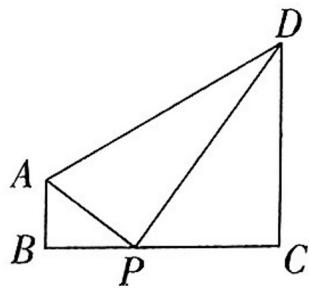
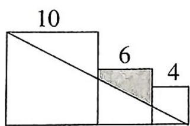

<!-- question-source:start -->
2 新考法 [2024 河北唐山期中, 中] 有一题目: “如图, 在四边形 $ABCD$ 中, $AB \parallel CD$ , $\angle B = \angle C = 90^{\circ}$ , $AB = 2$ , $BC = 7$ , $CD = 6$ . 当 $\triangle ABP$ 与 $\triangle PCD$ 相似时, 求 $BP$ 的长.” 嘉嘉的结果为 $BP = 3$ 或 4. 而淇淇说: “嘉嘉考虑的不周全, $BP$ 还应有另一个不同的值.” 下列判断正确的是 ( )

A. 淇淇说得对, 且 $BP$ 的另一个值是 $\frac{7}{4}$ B. 淇淇说得不对, $BP$ 就等于 3 或 4

C. 嘉嘉求的结果不对, $BP$ 应等于 3 或 5

D. 两人都不对, $BP$ 应有 4 个不同值

(第2题图)

(第3题图)
<!-- question-source:end -->

![[Q00107994A1]]
