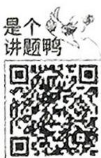

<!-- question-source:start -->
5[较难]如图,在三角形纸板 ABC 中,
AC=4,BC=2,AB=5,P 是 AC 上一点,过点 P 沿直线剪下一个与 $\triangle ABC$

相似的小三角形纸板,如果有4种不同的剪法,那么AP长的取值范围是\_\_\_\_.
<!-- question-source:end -->

![[Q00107997A1]]
