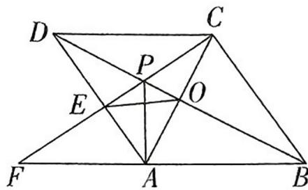

<!-- question-source:start -->
6[2024 山东枣庄期末, 中]如图, 点 P 是菱形 AB-CD 的对角线 BD 上一点, 连接 CP 并延长, 交 AD 于 E, 交 BA 的延长线于点 F, 连接 AC 交 BD 于 O, 连接 OE, AP.

(1) 求证: $PE \cdot PF = PC^{2}$ .

(2) 若 $CE \perp BC$ , 求证: $\triangle POC \sim \triangle AEC$ .

<!-- question-source:end -->

![[Q00107998A1]]
