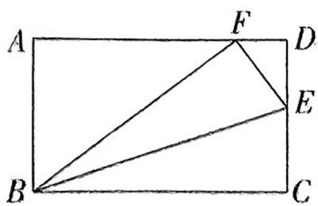
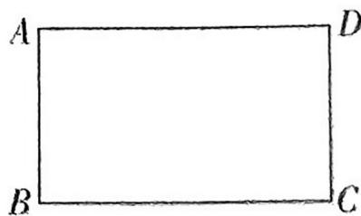

<!-- question-source:start -->
7 核心素养 几何直观 [2024 江苏南通崇川区期末, 难] 矩形 $ABCD$ 中, $AB<BC$ , $AB=6$ , $E$ 是射线 $CD$ 上一点, 点 $C$ 关于 $BE$ 的对称点 $F$ 恰好落在射线 $DA$ 上, 连接 $BF$ , $EF$ .

(1)如图,点 E 在边 CD 上,当 BC=10 时,DF 的长为\_\_\_\_;当 $AF \cdot DF = 9$ 时,DF 的长为\_\_\_\_.

(2)作 $\angle ABF$ 的平分线交射线 $DA$ 于点 $M$ ,当 $\frac{MF}{BC}=\frac{1}{2}$ 时,求 $DF$ 的长.

备用图
<!-- question-source:end -->

![[Q00107999A1]]
