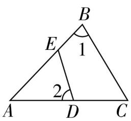
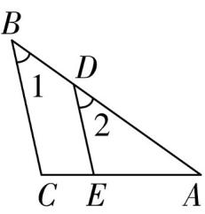
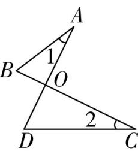
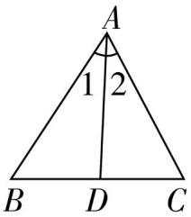

> [!success]- 必刷题
>
> > [!success] **【答案】** D
>
> > [!note]- **【解析】**
> > <table><tr><td>A</td><td>如图, ∵∠1=∠2, ∠A=∠A,∴△ABC∽△ADE</td><td></td><td>不符合题意</td></tr><tr><td>B</td><td>如图, ∵∠1=∠2, ∠A=∠A,∴△ABC∽△ADE</td><td></td><td>不符合题意</td></tr><tr><td>C</td><td>如图, ∵∠1=∠2, ∠AOB=∠COD,∴△AOB∽△COD</td><td></td><td>不符合题意</td></tr><tr><td>D</td><td>如图, 由∠1=∠2,不能得出两个三角形相似</td><td></td><td>符合题意</td></tr></table>
> >
> > 故选 **D**.
