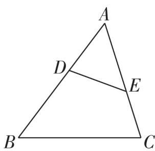

> [!success]- 必刷题
>
> > [!success] **【答案】** C
>
> > [!note]- **【解析】**
> > 【解】(1) 正确的比例式为 $\frac{DE}{BC} = \frac{AD}{AB}$ , $\therefore DE = \frac{AD}{AB} \cdot BC = \frac{AB - DB}{AB} \cdot BC = \frac{5}{3}$ . (2) 另一个错误为没有进行分类讨论. 如图, 过点 $D$ 作 $\angle ADE = \angle ACB$ , 则 $\triangle ADE \sim \triangle ACB$ ,
> >
> > $\therefore \frac{DE}{CB} = \frac{AD}{AC},$ $\therefore DE = \frac{5}{2}.$ 综上， $DE$ 的长为 $\frac{5}{3}$ 或 $\frac{5}{2}$
> >
> > 
