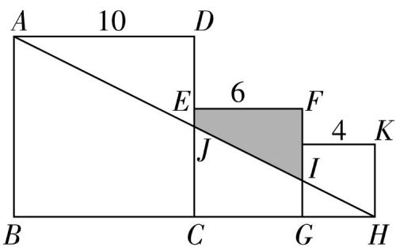

> [!success]- 必刷题
>
> > [!success] **【答案】** 15
>
> > [!note]- **【解析】**
> > 如图,由题意可知 $AD = DC = 10$ , $CG = CE = GF = 6$ , $\angle CEF = \angle EFG = 90^\circ$ , $GH = 4$ , $\therefore CH = 10 = AD$ . $\because \angle D = \angle DCH = 90^\circ$ , $\angle AJD = \angle HJC$ , $\therefore \triangle ADJ \cong \triangle HCJ$ , $\therefore CJ = DJ = 5$ , $\therefore EJ = 6 - 5 = 1$ . $\because GI // CJ$ , $\therefore \angle GIH = \angle CJH$ , $\angle IGH = \angle JCH$ , $\therefore \triangle HGI \sim \triangle HCJ$ , $\therefore \frac{GI}{CJ} = \frac{GH}{CH} = \frac{2}{5}$ , $\therefore GI = 2$ , $\therefore FI = 4$ , $\therefore S_{\text{阴影}} = \frac{1}{2} \times (1 + 4) \times 6 = 15$ . 故答案为 15.
> >
> > (2) 根据菱形的性质可得出 $\angle COP = \angle CEA,$ 从而证明结论.
> >
> > 
