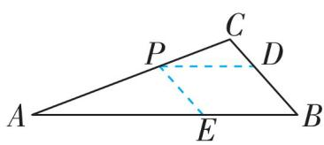
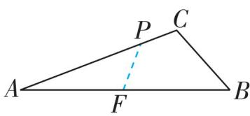
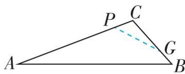

> [!success]- 必刷题
>
> > [!success] **【答案】** $3 \leqslant AP < 4$
>
> > [!note]- **【解析】**
> > 如图(1)所示, 过 $P$ 作 $PD \parallel AB$ 交 $BC$ 于 $D$ , $PE \parallel BC$ 交 $AB$ 于 $E$ , 则易知 $\triangle PCD \sim \triangle ACB$ , $\triangle APE \sim \triangle ACB$ , 此时 $0 < AP < 4$ .
> >
> > 
> >
> > 
> > 图(1)
> > 图(2)
> >
> > 如图(2)所示, 过 P 作 $\angle APF = \angle B$ 交 AB 于 F, 则 $\triangle APF \sim \triangle ABC$ , 此时 $0 < AP \leqslant 4$ .
> >
> > 如图(3)所示, 过 P 作 $\angle CPG = \angle CBA$ 交 BC
> > 于 G，则 $\triangle CPG \sim \triangle CBA$ ，此时 $3 \leqslant AP < 4$ .
> > 综上所述，要有 4 种不同
> > 取值范围是 $3 \leqslant AP < 4$ .
> >
> > 
> > 图(3)
> >
> > 综上所述,要有 4 种不同的剪法,则 AP 长的取值范围是 $3 \leqslant AP < 4$ .
