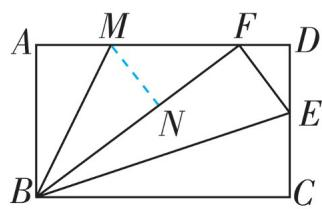
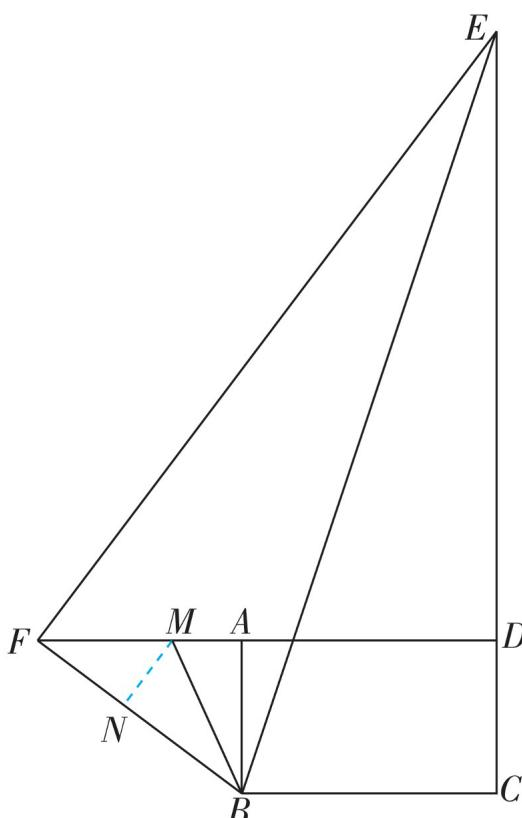

> [!success]- 必刷题
>
> > [!success] **【答案】** (1) 2 $3\sqrt{2}$
>
> > [!note]- **【解析】**
> > 当点 $E$ 在边 $CD$ 上, $BC = 10$ 时, $\because$ 点 $C$ 关于 $BE$ 的对称点 $F$ 恰好落在射线 $DA$ 上, $\therefore BF = BC = 10$ , $\therefore AF = \sqrt{BF^2 - AB^2} = \sqrt{10^2 - 6^2} = 8$ , $\therefore DF = AD - AF = 10 - 8 = 2$ . 当 $AF \cdot DF = 9$ 时, $\because$ 四边形 $ABCD$ 是矩形, $\therefore \angle A = \angle D = 90^\circ$ . 易知 $\angle BFE = 90^\circ$ , $\therefore \angle AFB + \angle DFE = 90^\circ$ . $\because \angle DEF + \angle DFE = 90^\circ$ , $\therefore \angle AFB = \angle DEF$ , $\therefore \triangle FAB \sim \triangle EDF$ ,$\therefore \frac{AF}{DE} = \frac{AB}{DF}, \therefore AF \cdot DF = AB \cdot DE. \because AF \cdot DF = 9, AB = 6, \therefore DE = \frac{3}{2}, \therefore CE = CD - DE = \frac{9}{2}. \because$ 点 $C$ 关于 $BE$ 的对称点 $F$ 恰好落在射线 $DA$ 上， $\therefore EF = CE = \frac{9}{2}, \therefore DF = \sqrt{EF^2 - DE^2} = 3\sqrt{2}.$
> >
> > (2)【解】①点 F 在 AD 边上时, 过点 M 作 $MN \perp BF$ 于点 N, 如图(1). ∵ BM 平分 $\angle ABF, MA \perp AB, MN \perp BF, \therefore MA = MN. \because \angle A =$
> >
> > 
> > 图(1)
> >
> > $\angle MNF = 90^{\circ}, \angle AFB = \angle NFM, \therefore \triangle FAB \sim \triangle FNM, \therefore \frac{MN}{AB} = \frac{MF}{BF}. \because \frac{MF}{BC} = \frac{1}{2}, BF = BC,$ $\therefore \frac{NM}{AB} = \frac{MF}{BF} = \frac{1}{2}. \because AB = 6, \therefore MN = 3 = AM.$ 在Rt△ABM和Rt△NBM中， $\left\{ \begin{array}{l} BM = BM, \\ AM = MN, \end{array} \right.$ $\therefore \mathrm{Rt}\triangle ABM \cong \mathrm{Rt}\triangle NBM(\mathrm{HL}), \therefore BN = AB = 6.$ 设 $MF = x$ ，则 $BF = BC = 2x, \therefore FN = 2x - 6.$ 在Rt△MNF中， $\because MN^{2} + FN^{2} = MF^{2}, \therefore 3^{2} + (2x - 6)^{2} = x^{2}$ ，解得 $x = 5$ 或 $x = 3$ （舍去）， $\therefore BC = 2x = 10, \therefore AD = BC = 10, \therefore DF = AD - AM - MF = 2.$
> > - **②**：点 F 在边 DA 的延长线上时, 过点 M 作 $MN \perp BF$ 于点 N, 如图(2). 同
> > - **①**：可得 AM = MN = 3, BC = AD = 10, MF = 5, ∴ DF = AD + AM + MF = 18. 综上, 当 $\frac{MF}{BC} = \frac{1}{2}$ 时, DF 的长为 2 或 18.
> >
> > 
> > 图(2)
> >
> > ## 课时 2 相似三角形的判定定理 2
