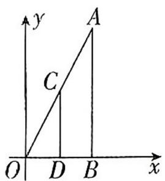
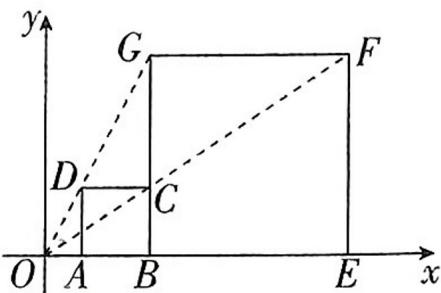

<!-- question-source:start -->
1 如图,在平面直角坐标系中,已知点 $A(2,4)$ , 过点 $A$ 作 $AB \perp x$ 轴于点 $B$ , 以坐标原点 $O$ 为位似中心, 将 $\triangle AOB$ 缩小为原图形的 $\frac{1}{2}$ 得到 $\triangle COD$ , 则 $CD$ 的长是 ( )
A. 1 B. 2 C. $2 \sqrt{5}$ D. $\sqrt{5}$

(第1题图)

(第2题图)
<!-- question-source:end -->

![[Q00108094A1]]
