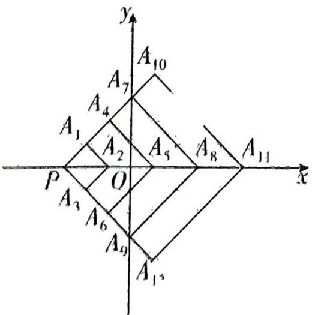
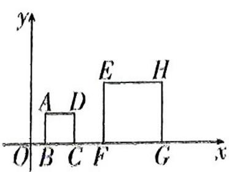

<!-- question-source:start -->
3 [2023 山东烟台中考]如图,在直角坐标系中,每个网格小正方形的边长均为1个单位长度,以点P为位似中心作正方形 $PA_{1}A_{2}A_{3}$ ,正方形 $PA_{4}A_{5}A_{6},\cdots$ ,按此规律作下去,所作正方形的顶点均在格点上,其中正方形 $PA_{1}A_{2}A_{3}$ 的顶点坐标分别为 $P(-3,0),A_{1}(-2,1),A_{2}(-1,0),A_{3}(-2,-1)$ ,则顶点 $A_{100}$ 的坐标为( )
A.(31,34) B.(31,-34)
C.(32,35) D.(32,0)

(第3题图)

(第4题图)

建议用时 25 分钟 答案 D67
<!-- question-source:end -->

![[Q00108096A1]]
