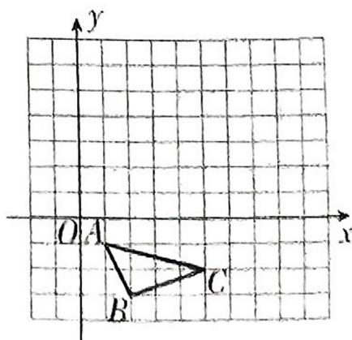

<!-- question-source:start -->
6 如图,在带有网格的平面直角坐标系中,每个小正方形的边长为一个单位长度,图中给出了三角形 ABC(点 A,B,C 均在格点上).
(1)作出△ABC关于x轴对称的△A'B'C';
(2)以坐标原点为位似中心在图中的网格中作出△A'B'C'的位似图形△A"B"C",使△A'B'C'与△A"B"C"的相似比为1:2;
(3)若△ABC的面积为3.5,求出△A"B"C"的面积.

是个新“烤”鸭

电子错题本鸭
<!-- question-source:end -->

![[Q00108099A1]]
