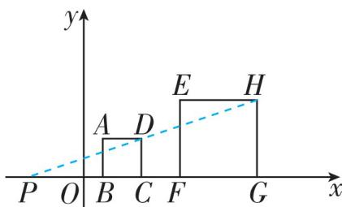
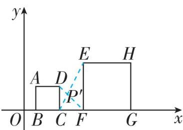

> [!success]- 必刷题
>
> > [!success] **【答案】** $(-3,0)$ 或 $\left(\frac{11}{3},\frac{4}{3}\right)$
>
> > [!note]- **【解析】**
> > 如图(1)，连接
> >
> > $HD$ 并延长交 $x$ 轴于点 $P$ , 则点 $P$ 为位似中心. ∵ 四边形 $ABCD$ 为正方形, 点 $A$ 的坐标为 (1,2), ∴ 点 $D$ 的坐标为 (3,2). ∵ $DC \parallel$
> >
> > 
> > 图(1)
> >
> > $HG, \therefore$ 易证 $\triangle PCD \sim \triangle PGH, \therefore \frac{PC}{PG} = \frac{CD}{HG}$ , 即 $\frac{OP+3}{OP+9} = \frac{2}{4}$ , 解得 $OP = 3, \therefore$ 正方形 $ABCD$ 与正方形 $EFGH$ 的位似中心的坐标是 $(-3,0)$ .
> >
> > 如图(2)，连接 CE, DF 交于点 $P'$ ，则点 $P'$ 为位似中心。由题意得 $C(3,0)$ , $E(5,4)$ , $D(3,2)$ , $F(5,0)$ ，则易求出
> >
> > 
> > 图(2)
> >
> > DF 所在直线表达式为 $y = -x + 5$ , CE 所在直线表达式为 y = 2x - 6. 联立两个表达式得 $\left\{\begin{aligned}y&=-x+5,\\ y&=2x-6,\end{aligned}\right.$ 解得 $\left\{\begin{aligned}x&=\frac{11}{3},\\ y&=\frac{4}{3},\end{aligned}\right.$ $\therefore DF, CE$ 的交点 $P'$ 的坐标为 $\left(\frac{11}{3},\frac{4}{3}\right)$ ，∴正方形ABCD与正方形EFGH的位似中心的坐标是 $\left(\frac{11}{3},\frac{4}{3}\right)$ . 故答案为 $(-3,0)$ 或 $\left(\frac{11}{3},\frac{4}{3}\right)$ .
