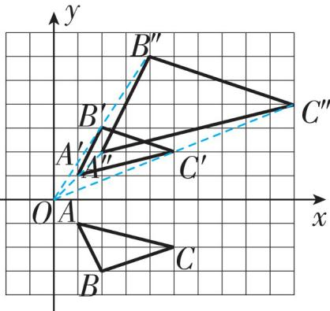

> [!success]- 必刷题
>
> > [!success] **【答案】** 详见解析
>
> > [!note]- **【解析】**
> > 【解】(1)如图所示, $\triangle A'B'C'$ 即为所求.
> > (2)如图所示, $\triangle A''B''C''$ 即为所求.
> > (3)由(1)知, $\triangle ABC \cong \triangle A'B'C', \therefore S_{\triangle A'B'C'} = S_{\triangle ABC} = 3.5$ .
> > 由(2)知, $\triangle A'B'C' \sim \triangle A''B''C''$ , 且相似比为 $1:2 = \frac{1}{2}, \therefore \frac{S_{\triangle A'B'C'}}{S_{\triangle A''B''C'}} = \left(\frac{1}{2}\right)^2 = \frac{1}{4}$ . 又 $\because S_{\triangle A'B'C'} = 3.5, \therefore S_{\triangle A''B''C''} = 4S_{\triangle A'B'C'} = 4 \times 3.5 = 14.$
> >
> > 
