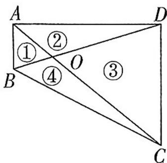
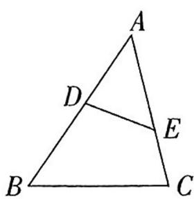
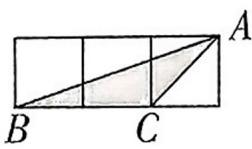

<!-- question-source:start -->
1 [2025 江苏南京质检]如图,四边形 ABCD 的对角线 AC,BD 相交于 O,且将这个四边形分成①②③④四个三角形,若 OA:OC=OB:OD,则下列结论正确的是 ( )
A. ①和②相似
B. ①和③相似
C. ①和④相似
D. ②和④相似

(第1题图)

(第2题图)

(第3题图)
<!-- question-source:end -->

![[Q00108000A1]]
