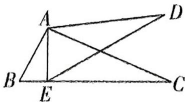

<!-- question-source:start -->
5 如图, $E$ 是 $\triangle ABC$ 的边 $BC$ 上的点, 已知 $\angle BAE = \angle CAD, \frac{AC}{AD} = \frac{6}{5}, AB = 18, AE = 15$ . 求证: $\triangle ABC \sim \triangle AED$ .

建议用时 25 分钟 答案 D52
<!-- question-source:end -->

![[Q00108004A1]]
