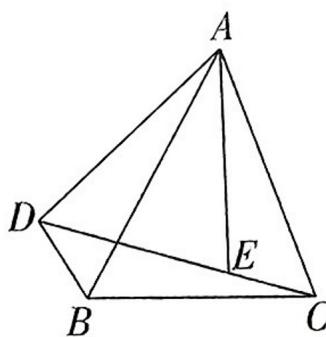

<!-- question-source:start -->
7 [2024 安徽合肥蜀山区期中] 如图, 点 $D$ 是 $\triangle ABC$ 外一点, 连接 $DC, E$ 是线段 $CD$ 上一点, $\angle DAE = \angle BAC$ , $\angle AEC + \angle ACB = 180^\circ$ . 求证: $\triangle DAB \sim \triangle EAC$ .

② 刷易错 小心有坑\~
<!-- question-source:end -->

![[Q00108006A1]]
