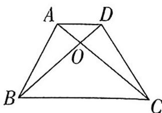

<!-- question-source:start -->
8 某学生的解答过程: $\triangle AOB \sim \triangle DOC$ . 理由: 在 $\triangle AOB$ 和 $\triangle DOC$ 中, $\because AD \parallel BC$ , $\therefore$ 易证 $\triangle AOD \sim \triangle COB$ ,

$\therefore \frac{AO}{OC} = \frac{OD}{OB}$ . 又 $\because \angle AOB = \angle DOC, \therefore \triangle AOB \sim \triangle DOC$ . 该学生的解答是否正确? 若不正确, 请说明理由.
<!-- question-source:end -->

![[Q00108007A1]]
