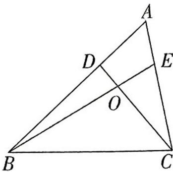

<!-- question-source:start -->
1 [2025 陕西西安质检, 中] 如图, $D, E$ 分别是

△ABC 的边 AB, AC 上的点,
且 $AD=\frac{1}{3}AB, AE=\frac{1}{3}AC, CD$ 与 BE 交于点 O，则 $S_{\triangle COE}$ ： $S_{\triangle BOC}$ 的值为（）
A. $\frac{1}{16}$ B. $\frac{1}{9}$ C. $\frac{1}{4}$

$$
\begin{array}{c} \frac {1}{3} \end{array}
$$
<!-- question-source:end -->

![[Q00108008A1]]
