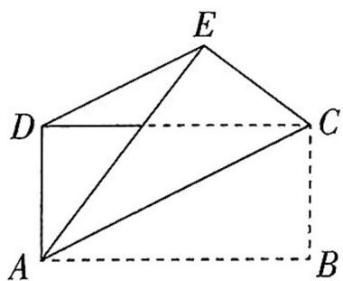
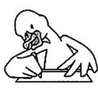

<!-- question-source:start -->
3[2025 贵州毕节校级质检, 中]如图, 已知四边形 ABCD 是矩形, 将矩形沿 AC 折叠, 点 B 落在点 E 处, 连接 DE. 若 DE:AC = 3:5, 则 $\frac{AD}{AB}$ 的值为 \_\_\_\_.

刷题先“疯”
<!-- question-source:end -->

![[Q00108010A1]]
