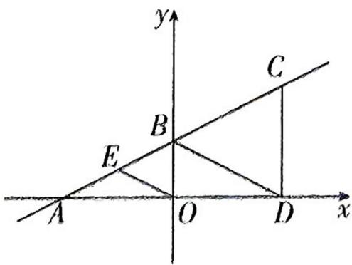

<!-- question-source:start -->
4[2025 四川成都质检,较难]如图,在平面直角坐标系 $xOy$ 中,一次函数 $y = \frac{1}{2} x + 2$ 的图象分别交 $x$ 轴, $y$ 轴于 $A, B$ 两点,过该函数图象上一点 $C(4,4)$ 作 $CD \perp x$ 轴于点 $D$ , 点 $E$ 是线段 $AB$ 上一动点, 连接 $BD, EO$ , 若以 $B, E, O$ 为顶点的三角形与 $\triangle BCD$ 相似, 则点 $E$ 的坐标为 \_\_\_\_.

<!-- question-source:end -->

![[Q00108011A1]]
