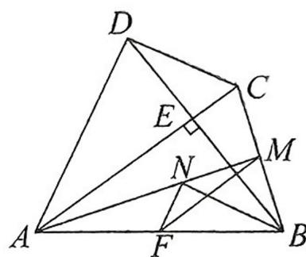

<!-- question-source:start -->
5[中]如图,四边形ABCD中, $AC \perp BD$ ,垂足为E,点F,M分别是AB,BC的中点,BN平分 $\angle ABE$ 交AM于点N, $AB = AC = BD$ ,连接MF,NF.求证:

(1) $BN = \sqrt{2} MN.$ (2) $\triangle MFN\sim \triangle BDC.$

<!-- question-source:end -->

![[Q00108012A1]]
