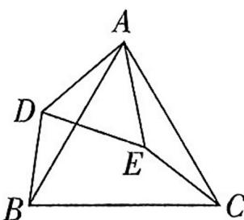
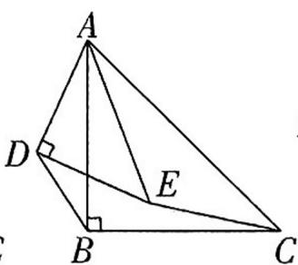
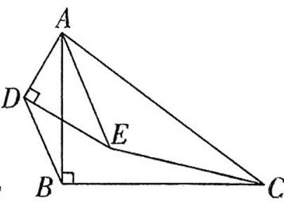

<!-- question-source:start -->
6 核心素养推理能力 [2024 江西宜春期末,较难] (1)如图(1), $\triangle ABC$ 和 $\triangle ADE$ 都是等边三角形,连接 $BD, CE$ . 求证: $BD=CE$ .

(2)如图(2), $\triangle ABC$ 和 $\triangle ADE$ 都是等腰直角三角形, $\angle ABC = \angle ADE = 90^{\circ}$ . 连接 $BD, CE$ . 请直接写出 $\frac{BD}{CE}$ 的值.

(3)如图(3), $\triangle ABC$ 和 $\triangle ADE$ 都是直角三角形, $\angle ABC = \angle ADE = 90^\circ$ , 且 $\frac{AB}{BC} = \frac{AD}{DE} = \frac{3}{4}$ . 连接 $BD, CE$ . 求 $\frac{BD}{CE}$ 的值.

图(1)

图(2)

图(3)
<!-- question-source:end -->

![[Q00108013A1]]
