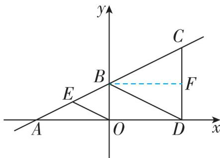

> [!success]- 必刷题
>
> > [!success] **【答案】** $\left(-\frac{8}{5}, \frac{6}{5}\right)$ 或 $(-2, 1)$
>
> > [!note]- **【解析】**
> > 设 $E\left(t, \frac{1}{2} t + 2\right)$ . 当 $y = 0$ 时, $\frac{1}{2} x + 2 = 0$ , 解得 $x = -4$ ,
> >
> > $\therefore A(-4,0)$ . 当 $x = 0$ 时, $y = \frac{1}{2} x + 2 = 2$ , $\therefore B(0,2)$ . 如图, 过点 $B$ 作 $BF \perp CD$ , 垂足为 $F$ . $\because C(4,4)$ ,
> >
> > 
> >
> > $CD \perp x$ 轴, $\therefore OD = 4, CD = 4, \therefore$ 易得 $BF = 4$ , $CF = 2, \therefore BC = \sqrt{4^2 + 2^2} = 2\sqrt{5}$ . $\because CD \parallel OB$ , $\therefore \angle EBO = \angle BCD$ . 若以 $B, E, O$ 为顶点的三角形与 $\triangle BCD$ 相似, 则有以下两种情况: ① 当 $\frac{BE}{CB} = \frac{BO}{CD}$ 时, $\triangle BEO \sim \triangle CBD$ , 即 $\frac{BE}{2\sqrt{5}} = \frac{2}{4}$ , 解得 $BE = \sqrt{5}, \therefore t^2 + \left(\frac{1}{2}t + 2 - 2\right)^2 = 5$ , 解得 $t_1 = 2$ (舍去), $t_2 = -2$ , 此时 $E$ 点坐标为 $(-2, 1)$ . ② 当 $\frac{BE}{CD} = \frac{BO}{CB}$ 时, $\triangle BEO \sim \triangle CDB$ , 即 $\frac{BE}{4} = \frac{2}{2\sqrt{5}}$ , 解得 $BE = \frac{4\sqrt{5}}{5}, \therefore t^2 + \left(\frac{1}{2}t + 2 - 2\right)^2 = \frac{16}{5}$ , 解得 $t_1 = \frac{8}{5}$ (舍去), $t_2 = -\frac{8}{5}$ , 此时 $E$ 点坐标为 $\left(-\frac{8}{5}, \frac{6}{5}\right)$ . 综上所述, $E$ 点坐标为 $\left(-\frac{8}{5}, \frac{6}{5}\right)$ 或 $(-2, 1)$ . 故答案为 $\left(-\frac{8}{5}, \frac{6}{5}\right)$ 或 $(-2, 1)$ .
