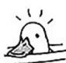

## 课时 2 相似三角形的判定定理 2 刷基础

## 刷基础

## 知识点 1 两边成比例且夹角相等的两个三角形相似

![[初中/课堂同步/教辅/必刷题/2026《初中必刷题》数学北师9上/04_第四章_图形的相似/课时_2_相似三角形的判定定理_2/questions/Q00108000.md]]
![[初中/课堂同步/教辅/必刷题/2026《初中必刷题》数学北师9上/04_第四章_图形的相似/课时_2_相似三角形的判定定理_2/questions/Q00108001.md]]
![[初中/课堂同步/教辅/必刷题/2026《初中必刷题》数学北师9上/04_第四章_图形的相似/课时_2_相似三角形的判定定理_2/questions/Q00108002.md]]
![[初中/课堂同步/教辅/必刷题/2026《初中必刷题》数学北师9上/04_第四章_图形的相似/课时_2_相似三角形的判定定理_2/questions/Q00108003.md]]
![[初中/课堂同步/教辅/必刷题/2026《初中必刷题》数学北师9上/04_第四章_图形的相似/课时_2_相似三角形的判定定理_2/questions/Q00108004.md]]

## 知识点 2 相似三角形的判定与性质的综合

![[初中/课堂同步/教辅/必刷题/2026《初中必刷题》数学北师9上/04_第四章_图形的相似/课时_2_相似三角形的判定定理_2/questions/Q00108005.md]]
![[初中/课堂同步/教辅/必刷题/2026《初中必刷题》数学北师9上/04_第四章_图形的相似/课时_2_相似三角形的判定定理_2/questions/Q00108006.md]]

## 易错点 错用判定定理 2 致错

老师上完“相似三角形的判定”一课后,出了如下一道思考题:如图,在四边形ABCD中,AD//BC,对角线AC,BD相交于点O,△AOB和△DOC是否相似?

![[初中/课堂同步/教辅/必刷题/2026《初中必刷题》数学北师9上/04_第四章_图形的相似/课时_2_相似三角形的判定定理_2/questions/Q00108007.md]]
