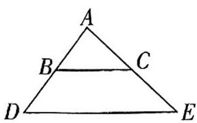
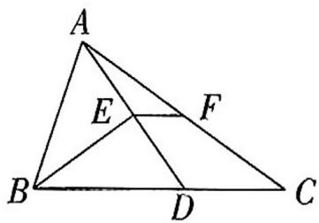

<!-- question-source:start -->
4[2024 福建三明调研]如图, $\triangle ABC \sim \triangle ADE$ , $B$ , $C$ 分别在 $AD, AE$ 上, $S_{\triangle ABC}: S_{\text{四边形} BDEC} = 1:3$ , $BC = \sqrt{2}$ , 则 $DE$ 的长为 ( )
A. $\sqrt{6}$ B. $2\sqrt{2}$ C. $3\sqrt{2}$ D. $4\sqrt{2}$

(第4题图)

(第 5 题图)

<!-- question-source:end -->

![[Q00107621A1]]
