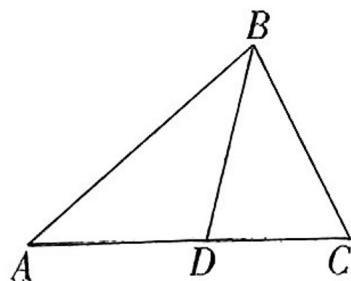

<!-- question-source:start -->
8[2025 安徽滁州调研]如图,在 $\triangle ABC$ 中, $D$ 是 $AC$ 上一点, $\frac{CB}{CD}=\frac{CA}{CB}=\frac{3}{2}$ , $\triangle BCD$ 的周长是24 cm.

(1) 求 $\triangle ABC$ 的周长；

(2) 求 $\triangle BCD$ 与 $\triangle ABD$ 的面积比.

<!-- question-source:end -->

![[Q00107625A1]]
