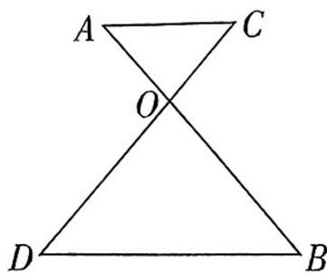

<!-- question-source:start -->
1 [2024 云南中考] 如图, $AB$ 与 $CD$ 交于点 $O$ , 且 $AC \parallel BD$ . 若 $\frac{OA + OC + AC}{OB + OD + BD} = \frac{1}{2}$ , 则 $\frac{AC}{BD} =$ \_\_\_\_.

<!-- question-source:end -->

![[Q00108072A1]]
