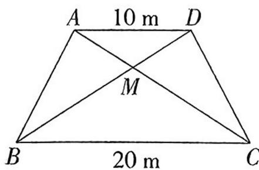

<!-- question-source:start -->
2 两个相似三角形对应角平分线的比为 2:3, 周长差是 25, 求较大三角形的周长.

建议用时 25 分钟 答案 D62

于点 M. 计划在 $\triangle AMD$ 和 $\triangle BMC$ 区域种植单价为 10 元/ $m^{2}$ 的太阳花.

(1) 写出 $\triangle ABM$ 与 $\triangle DMC$ 的面积的大小关系, 并说明理由.

(2) 当 $\triangle AMD$ 种满花后, 已知花了 500 元钱, 若继续在 $\triangle BMC$ 上种植同样的太阳花, 资金是否够用? 请说明理由.

<!-- question-source:end -->

![[Q00108073A1]]
