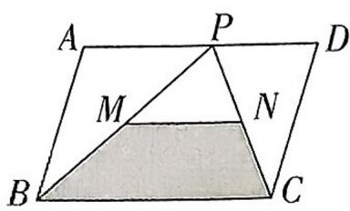
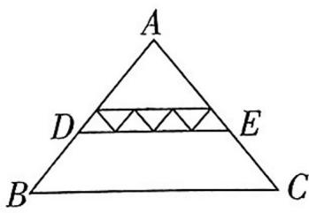

<!-- question-source:start -->
1 [2025 河北邯郸期中, 中]如图, 在 $\square ABCD$ 中, $P$ 是 $AD$ 边上的一个点, 连接 $PB, PC, M, N$ 分别是 $PB, PC$ 的中点. 若 $S_{\text{四边形 } BMNC} = 6$ , 则 $S_{\square ABCD}$ 的值是 ( )
A. 12 B. 14 C. 16 D. 18

(第1题图)

(第2题图)
<!-- question-source:end -->

![[Q00108074A1]]
