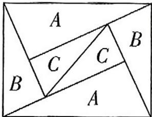

<!-- question-source:start -->
3 [2024 浙江宁波质检, 中] 如图是一个由 $A, B, C$ 三种相似的直角三角形纸片拼成的矩形, $A, B, C$ 纸片的面积分别为 $S_{1}, S_{2}, S_{3}$ ( $C$ 与 $B, B$ 与 $A$ 的相似比相同), 相邻纸片之间互不重叠也无缝隙, 若 $S_{1} > S_{2} > S_{3}$ , 则这个矩形的面积一定可以表示为 ( )

你题还怪好的嘞

A. $4S_{1}$ B. $6S_{2}$ C. $4S_{2} + 3S_{3}$ D. $3S_{1} + 4S_{3}$
<!-- question-source:end -->

![[Q00108076A1]]
