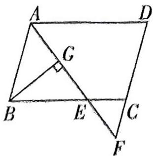
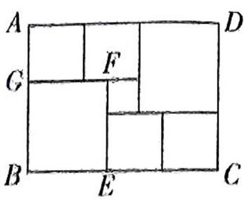

<!-- question-source:start -->
4[2025 山东德州质检, 中]如图, 在 $\square ABCD$ 中, $AB = 10, AD = 15$ , $\angle BAD$ 的平分线交 $BC$ 于点 $E$ , 交 $DC$ 的延长线于点 $F$ , $BG \perp AE$ 于点 $G$ , 若 $BG = 8$ , 则 $\triangle CEF$ 的周长为 \_\_\_\_.

(第4题图)

(第5题图)
<!-- question-source:end -->

![[Q00108077A1]]
