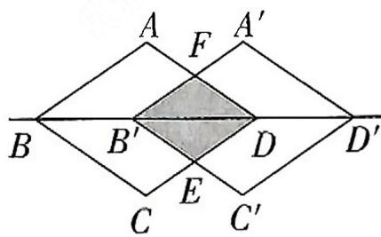

<!-- question-source:start -->
7 [2025 贵州六盘水校级质检, 中] 如图, 把菱形 ABCD 沿着 BD 的方向平移到菱形 $A'B'C'D'$ 的位置, 两个菱形的重叠部分为四边形 $B'EDF$ .

(1) 求证: 四边形 $B'EDF$ 是菱形;

(2)若四边形 $B'EDF$ 面积是菱形 $ABCD$ 面积的一半, 且 $BD = \sqrt{2}$ , 求菱形 $ABCD$ 平移的距离.

<!-- question-source:end -->

![[Q00108080A1]]
