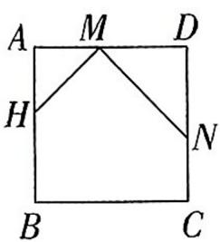
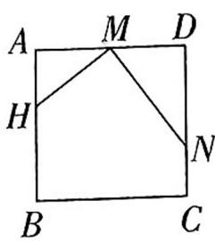
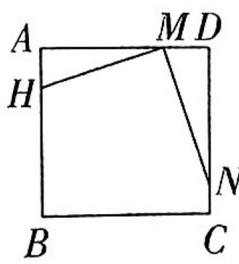

<!-- question-source:start -->
8 新考法 [2025 广西玉林期末, 中] 如图(1), 在边长为 4 的正方形 ABCD 中, 点 H 为 AB 上一动点, 且 $2 \leqslant BH < 4$ , 截取 HM = HB, 且 HM 交线段 AD 于 M, 过 M 作 HM 的垂线 MN 交 DC 于 N.
(1) 求证: $\triangle AHM \sim \triangle DMN$ ;
(2) 如图(2), 若点 M 是 AD 的中点, 求 $\triangle DMN$ 的周长;
(3) 在动点 H 逐渐向点 A 运动(HB 逐渐增大)的过程中, $\triangle DMN$ 的周长如何变化? 请说明理由.

图(1)

图(2)

备用图
<!-- question-source:end -->

![[Q00108081A1]]
