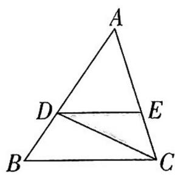
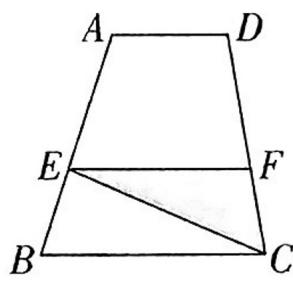

<!-- question-source:start -->
9 核心素养模型观念 [较难] 如图(1)所示, 在 $\triangle ABC$ 中, $AB = 4$ , $D$ 是 $AB$ 上一点 (不与 $A, B$ 重合), $DE \parallel BC$ 交 $AC$ 于点 $E$ , 连接 $CD$ . 设 $\triangle ABC$ 的面积为 $S$ , $\triangle DEC$ 的面积为 $S'$ . (1) 当 $AD = 3$ 时, $\triangle ADE$ 的面积是 6 , 求 $S'$ 的值; (2) 当 $AD = 3$ 时, 求 $S$ 的值 (结果用含字母 $S'$ 的代数式表示); (3) 如图(2)所示, 在四边形 $ABCD$ 中, $AB = 4$ , $AD \parallel BC$ , $AD = \frac{1}{2} BC$ , $E$ 是 $AB$ 上一点 (不与 $A, B$ 重合), $EF \parallel BC$ 交 $CD$ 于点 $F$ , 连接 $CE$ . 设 $AE = n$ , 四边形 $ABCD$ 的面积为 $S$ , $\triangle CEF$ 的面积为 $S'$ , 请你利用前面问题的解法或结论, 用含字母 $n$ 的代数式表示 $\frac{S'}{S}$ .

图(1)

图(2)
<!-- question-source:end -->

![[Q00108082A1]]
