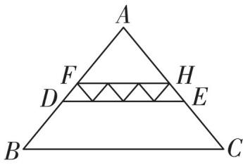

> [!success]- 必刷题
>
> > [!success] **【答案】** D
>
> > [!note]- **【解析】**
> > $$
> > \triangle A F H \sim \triangle A D E, F H:
> > $$
> >
> > $$
> > D E = 3:
> > $$
> >
> > 
> >
> > $$
> > \therefore \frac {S _ {\triangle A F H}}{S _ {\triangle A D E}} =
> > $$
> >
> > $$
> > \left(\frac {F H}{D E}\right) ^ {2} = \frac {9}{1 6}.
> > $$
> >
> > $$
> > S _ {\triangle A F H} = 9 x
> > $$
> >
> > $$
> > S _ {\triangle A D E} = 1 6 x
> > $$
> >
> > $$
> > \therefore 1 6 x - 9 x = 7
> > $$
> >
> > $$
> > x = 1, \therefore S _ {\triangle A D E} = 1 6, \therefore
> > $$
> >
> > $$
> > D B C E
> > $$
> >
> > $$
