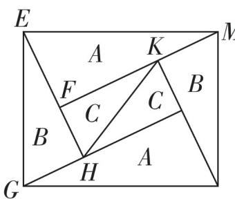

> [!success]- 必刷题
>
> > [!success] **【答案】** A
>
> > [!note]- **【解析】**
> > 如图, 由 $A, B$ , $C$ 三种直角三角形纸片相似, 且 $C$ 与 $B, B$ 与 $A$ 的相似比相同, 设其相似比为 $k$ , $EF = m$ , 则 $GH = mk$ ,
> >
> > 
> >
> > $FH = mk^{2}, \therefore EH = m(1 + k^{2}), \therefore FM = \frac{m(1 + k^{2})}{k},$ $FK = km(1 + k^{2})$ ，则 $km(1 + k^{2}) + mk = \frac{m(1 + k^{2})}{k}$ ,
> > 整理得 $k^{4}+k^{2}-1=0,\therefore k^{2}=\frac{-1+\sqrt{5}}{2}$ 或 $\frac{-1-\sqrt{5}}{2}$ （舍去）， $\therefore S_{2}=\frac{-1+\sqrt{5}}{2}S_{1},S_{3}=\left(\frac{-1+\sqrt{5}}{2}\right)^{2}S_{1}=$ $\frac{3-\sqrt{5}}{2}S_{1},\therefore S_{2}+S_{3}=S_{1},\therefore$ 这个矩形的面积为 $2S_{1}+2(S_{2}+S_{3})=4S_{1}$ .
> >
> > 故选 **A**.
