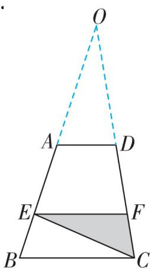

> [!success]- 必刷题
>
> > [!success] **【答案】** 详见解析
>
> > [!note]- **【解析】**
> > 【解】(1)∵ AB=4,AD=3,∴ BD=1.
> > ∵ DE∥BC,∴ CE:AE=BD:AD=1:3,
> > ∴ S′:S $_{\triangle ADE}$ =CE:AE=1:3.
> > ∵ △ADE 的面积是 6,∴ S′= $\frac{1}{3}$ ×6=2.
> > (2)∵ DE∥BC,∴ 易得△ADE∽△ABC.
> > 又∵ AD:AB=3:4,∴ $\frac{S_{\triangle ADE}}{S}=\left(\frac{3}{4}\right)^{2}=\frac{9}{16}$ ,
> > ∴ S= $\frac{16}{9}$ S $_{\triangle ADE}$ .
> > 由(1)知 S′= $\frac{1}{3}$ S $_{\triangle ADE}$ ,∴ S= $\frac{16}{3}$ S′.
> > (3)延长 BA,CD 交于点 O,如
> > 图.∵ AD∥BC,∴ 易得△OAD∼
> > △OBC,∴ $\frac{OD}{OC}=\frac{OA}{OB}=\frac{AD}{BC}=\frac{1}{2}$ ,
> > ∴ OA=AB=4,OB=8.∵ AE=
> > n,∴ OE=4+n,BE=4-n.
> >
> > 
> >
> > $\because EF \parallel BC, \therefore \frac{CF}{OF} = \frac{BE}{OE} = \frac{4 - n}{4 + n}$ , 且易得 $\triangle OEF \sim \triangle OBC, \therefore \frac{S_{\triangle OEF}}{S_{\triangle OBC}} = \left(\frac{OE}{OB}\right)^2, \therefore \frac{S_{\triangle CEF}}{S_{\triangle OBC}} = \frac{S_{\triangle CEF}}{S_{\triangle OEF}} \cdot \frac{S_{\triangle OEF}}{S_{\triangle OBC}} = \frac{4 - n}{4 + n} \cdot \left(\frac{4 + n}{8}\right)^2 = \frac{16 - n^2}{64}.$ $\because \frac{S_{\triangle OAD}}{S_{\triangle OBC}} = \left(\frac{OA}{OB}\right)^2 = \frac{1}{4}, \therefore \frac{S_{\text{四边形}ABCD}}{S_{\triangle OBC}} = \frac{3}{4},$ $\therefore \frac{S'}{S} = \frac{S_{\triangle CEF}}{\frac{3}{4} S_{\triangle OBC}} = \frac{4}{3} \times \frac{16 - n^2}{64} = \frac{16 - n^2}{48}.$
> >
> > ## 微专题
