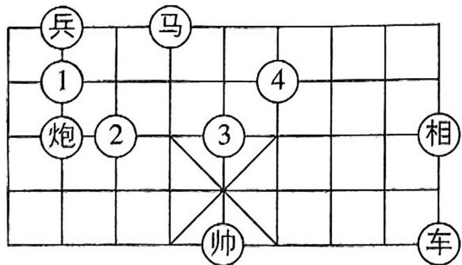

<!-- question-source:start -->
3 新考向传统文化 [2025 山东济南期中]象棋是中国棋文化,也是中华民族的文化瑰宝,它源远流长,趣味浓厚,基本规则简明易懂.如图是象棋的棋盘局部(各个小正方形的边长均相等),根据“马走日”的规则,“马”应该落在位置\_\_\_\_处,能使“马”“炮”“兵”所在位置的格点构成的三角形与“帅”“车”“相”所在位置的格点构成的三角形相似.

<!-- question-source:end -->

![[Q00108016A1]]
