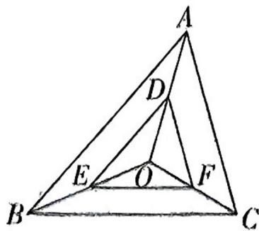

<!-- question-source:start -->
4 如图, 已知 $O$ 是 $\triangle ABC$ 内一点, $D, E, F$ 分别是 $OA, OB, OC$ 的中点. 求证: $\triangle ABC \sim \triangle DEF$ .

建议用时 20 分钟 答案 D54
<!-- question-source:end -->

![[Q00108017A1]]
