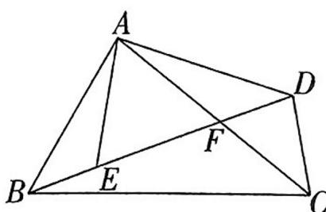

<!-- question-source:start -->
6 如图, 在四边形 $ABCD$ 中, $AC, BD$ 相交于点 $F$ , 点 $E$ 在 $BD$ 上, 且 $\frac{AB}{AE} = \frac{BC}{ED} = \frac{AC}{AD}$ . (1) $\angle BAE$ 与 $\angle CAD$ 相等吗? 为什么? (2) 试判断 $\triangle ABE$ 与 $\triangle ACD$ 是否相似, 并说明理由.

<!-- question-source:end -->

![[Q00108019A1]]
