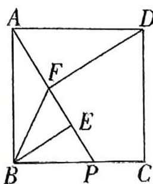

<!-- question-source:start -->
7[2024 河北石家庄期中]如图, 正方形 $ABCD$ 中, $P$ 是边 $BC$ 上一点, $BE \perp AP$ , $DF \perp AP$ , 垂足分别是点 $E, F$ , 连接 $BF$ , 如果 $\frac{AF}{BF} = \frac{DF}{AD}$ , 求证: $EF = EP$ .

②刷易错 小心有坑\~
<!-- question-source:end -->

![[Q00108020A1]]
