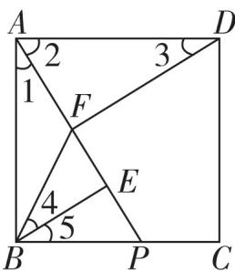

> [!success]- 必刷题
>
> > [!success] **【答案】** BE
>
> > [!note]- **【解析】**
> > 【证明】如图,∵四边形ABCD为正方形,∴AB=AD,∠BAD=90°.∵BE⊥AP,DF⊥AP,∴∠BEA=∠AFD=90°,∴∠1+∠2=∠2+∠3=90°,∴∠1=∠3.
> >
> > 
> >
> > 在 $\triangle ABE$ 和 $\triangle DAF$ 中， $\left\{ \begin{array}{l} \angle BEA = \angle AFD, \\ \angle 1 = \angle 3, \\ AB = DA, \end{array} \right.$ $\therefore \triangle ABE \cong \triangle DAF, \therefore BE = AF.$ 又 $\because \frac{AF}{BF} = \frac{DF}{AD},$ $\therefore \frac{BE}{BF} = \frac{DF}{AD}, \therefore \frac{BE}{DF} = \frac{BF}{AD}, \therefore$ 结合勾股定理易知 $\frac{BE}{DF} = \frac{BF}{AD} = \frac{EF}{AF}, \therefore \triangle BEF \sim \triangle DFA, \therefore \angle 4 = \angle 3.$ 又 $\because \angle 1 = \angle 3, \therefore \angle 4 = \angle 1. \because \angle 1 + \angle APB = \angle 5 + \angle APB = 90^\circ, \therefore \angle 5 = \angle 1, \therefore \angle 4 = \angle 5,$ 即 $BE$ 平分 $\angle FBP. \because BE \perp EP, \therefore$ 易得 $\triangle BEP \cong \triangle BEF, \therefore EF = EP.$
> >
> > ## 刷易错·
> >
> > ## 易错警示
