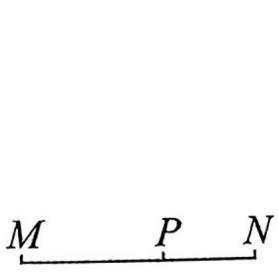
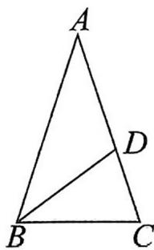

<!-- question-source:start -->
4 定义:如图(1),点 P 在线段 MN 上,若满足 $MP^{2}=PN \cdot MN$ ,则称点 P 为线段 MN 的黄金分割点.如图(2),在 $\triangle ABC$ 中,AB=AC=1, $\angle A=36^{\circ}$ ,BD 平分 $\angle ABC$ ,交 AC 于点 D.

(1)求证:点 D 是线段 AC 的黄金分割点.

(2)求出线段 ${AD}$ 的长.

图（1）

图（2）
<!-- question-source:end -->

![[Q00108025A1]]
