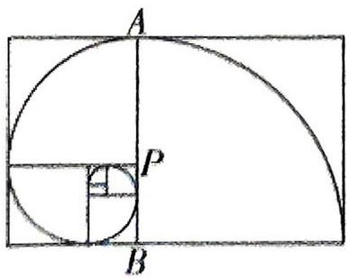
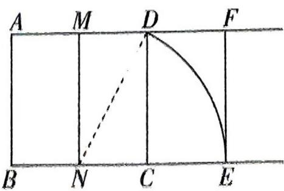

<!-- question-source:start -->
5 鹦鹉螺曲线的每个半径和后一个半径的比都是黄金比例,是自然界最美的鬼斧神工.如图,点P是AB的黄金分割点(AP>BP),若线段AB的长为6cm,则AP的长为 ( )
A. $(3\sqrt{5}-3)$ cm B. $(3-\sqrt{5})$ cm
C. $(9-3\sqrt{5})$ cm D. $(\sqrt{5}-1)$ cm

(第5题图)

(第6题图)

<!-- question-source:end -->

![[Q00108026A1]]
