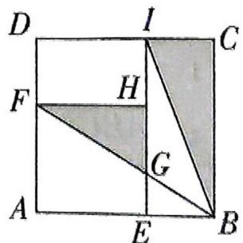

<!-- question-source:start -->
9[2024 浙江温州鹿城区期末]如图, 点 E 是正方形 ABCD 的边 AB 上的黄金分割点, 且 AE > EB, 以 AE 为边作正方形 AEHF, F 在 AD 上, 延长 EH 交 CD 于点 I, 连接 BF 交 EI 于点 G, 连接 BI, 则 $S_{\triangle BCI}: S_{\triangle FGH}$ 的值为 \_\_\_\_.

@刷易错 小心有坑\~ 易错点 计算时因考虑不全面致错

<!-- question-source:end -->

![[Q00108030A1]]
