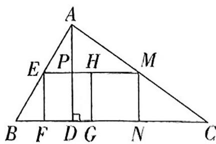

<!-- question-source:start -->
2 任意三角形内接四边形 [2025 山东菏泽质检, 中] 如图, 在 $\triangle ABC$ 中, $AD \perp BC$ , 垂足为 $D$ ,

$AD = 5, BC = 10$ , 四边形 $EFGH$ 和四边形 $HGNM$ 均为正方形, 且点 $E$ , $F, G, N, M$ 都在 $\triangle ABC$

的边上, $EH$ 与 $AD$ 交于点 $P$ , 那么 $\triangle AEM$ 与四边形 $BCME$ 的面积比为 \_\_\_\_.

难关 资料更新，关注公众号★全科AA+
<!-- question-source:end -->

![[Q00108083A1]]
