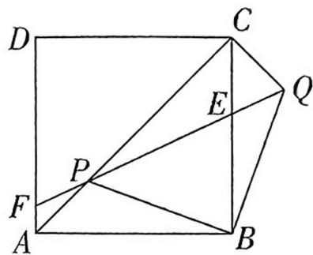

<!-- question-source:start -->
3 [2024 四川宜宾调研, 中] 如图, 正方形 $ABCD$ 中, $P$ 是对角线 $AC$ 上的一个动点 (不与 $A, C$ 重合), 连接 $BP$ , 将 $BP$ 绕点 $B$ 顺时针旋转 $90^{\circ}$ 到 $BQ$ , 连接 $QP$ 交 $BC$ 于点 $E, QP$ 延长线与边 $AD$ 交于点 $F$ .

(1) 连接 $CQ$ , 求证: $AP = CQ$ ;

(2) 若 ${AP} = \frac{1}{4}{AC}$ ,求 ${CE} : {BC}$ 的值.

<!-- question-source:end -->

![[Q00108084A1]]
