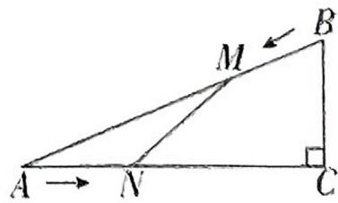

<!-- question-source:start -->
4 [较难] 如图, 在 Rt△ABC 中, ∠C = 90°, BC = 5 cm, AC = 12 cm. 点 M 在边 AB 上以 2 cm/s 的速度由点 B 出发沿 BA 向点 A 匀速运动, 同时点 N 在边 AC 上以 1 cm/s 的速度由点 A 出发沿 AC 向点 C 匀速运动. 点 M 到达点 A 时, 点 M, N 同时停止运动, 连接 MN, 设点 N 运动的时间为 t s.

(1) 求 ${AB}$ 的长.

(2) 当 $t$ 为何值时, $\triangle AMN$ 的面积为 $\triangle ABC$ 面积的 $\frac{3}{26}$ ?

(3)是否存在 $t$ 值, 使得以 $A, M, N$ 为顶点的三角形与 $\triangle ABC$ 相似? 若存在, 请求出 $t$ 的值; 若不存在, 请说明理由.

<!-- source-part:4 pages:76-100 -->

电子错题本鸭
<!-- question-source:end -->

![[Q00108085A1]]
