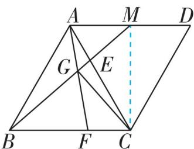

> [!success]- 必刷题
>
> > [!success] **【答案】** 详见解析
>
> > [!note]- **【解析】**
> > 【证明】(1)∵四边形ABCD是菱形,∴AD∥BC,∴∠MAB+∠ABC=180°.∵∠BGF=∠ABC,∠AGB+∠BGF=180°,∴∠AGB=∠MAB.又∵∠ABG=∠MBA,∴△BAG∽△BMA.
> >
> > (2) 连接 CM, 如图. ∵ 四边形 ABCD 为菱形, ∴ AB = BC = CD. ∵ ∠ABC = 60°, ∴ △ABC 为等边三
> >
> > 
> >
> > 角形, $\therefore AB = BC = AC, \therefore AC = CD. \because M$ 为 $AD$ 的中点, $\therefore CM \perp AD. \because AD \parallel BC, \therefore CM \perp BC, \therefore \angle MCB = 90^\circ$ . 由 (1) 得 $\triangle BAG \sim \triangle BMA$ , $\therefore \frac{AB}{BM} = \frac{BG}{AB}, \therefore BG \cdot BM = AB^2, \therefore BG \cdot BM = BC^2, \therefore \frac{BG}{BC} = \frac{BC}{BM}$ . 又 $\because \angle CBG = \angle MBC$ , $\therefore \triangle BGC \sim \triangle BCM, \therefore \angle BGC = \angle BCM = 90^\circ$ , $\therefore CG \perp BM$ .
